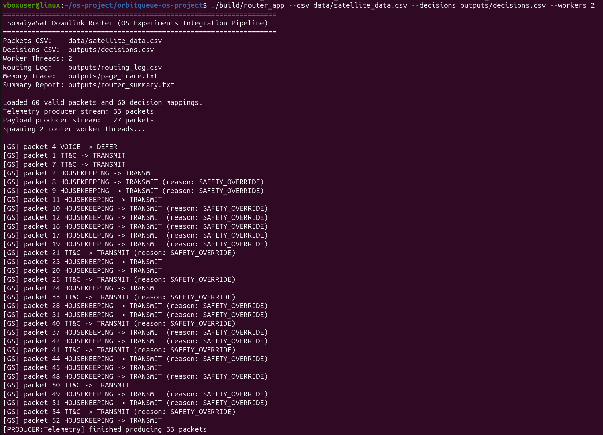
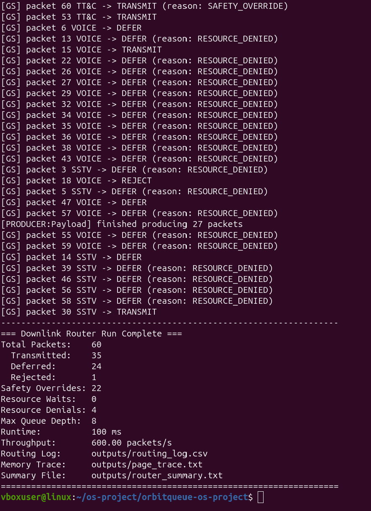

<!-- OWNER: Nidhi -->
# Section 2: Architecture and Development Tools

## 2.1 System Architecture Overview

The OrbitQueue software architecture unifies packet scheduling, multi-threaded synchronization, deadlock avoidance, and memory management into a cohesive downlink router pipeline. The definitive architectural diagram is formalized in [`docs/architecture.mmd`](../../docs/architecture.mmd).

The runtime execution flow proceeds through five interconnected stages:

1. **Synthetic Data Ingestion & Validation:** Synthetic packet definitions (`data/satellite_data.csv`) are parsed and validated by `csv_loader.cpp`, filtering invalid rows into `logs/rejected_rows.log`.
2. **Decision Generation:** Machine learning models (`ml/train_router.py`) and a baseline heuristic (`ml/baseline.py`) classify packets into `outputs/decisions.csv`, recommending `TRANSMIT`, `DEFER`, or `REJECT` based on urgency, link quality, and battery reserves.
3. **Priority Queue Ingestion (Experiment 7):** Valid packets are partitioned into dual concurrent producer streams: `TelemetryProducer` (critical: TT&C, HOUSEKEEPING) and `PayloadProducer` (bulk: SSTV, VOICE). Both streams push into the thread-safe `PacketQueue` (8-slot capacity, with 2 slots strictly reserved for critical packets).
4. **Router Engine & Resource Evaluation (Experiment 9):** Worker threads concurrently dequeue the highest-priority packets. The router verifies model decisions against a hard safety override rule (critical packets are forced to `TRANSMIT`). Before downlink dispatch, the router evaluates resource safety using Dijkstra's Banker's Algorithm (`resource_manager.h`) across CPU slots, buffer units, and transmitter availability.
5. **Memory Access Tracing & Virtual Memory Analysis (Experiments 8 & 10):** Every packet processing step logs an ordered, deterministic sequence of 9 memory accesses across 5 segments into `outputs/page_trace.txt`. This real multi-threaded trace string subsequently drives Experiment 8 address translation (paging and segmentation) and Experiment 10 virtual memory page replacement benchmarks (FIFO, LRU, Optimal).
6. **Ground-Station Dispatch & Metrics Reporting:** Actions are committed to `outputs/routing_log.csv` and logged to the ground station console (`[GS]`), with an end-of-run performance summary saved to `outputs/router_summary.txt`.

---

## 2.2 Component Responsibilities and Modular Structure

The codebase is split into modular components adhering to strict interface boundaries defined in `docs/INTERFACES.md`:

| Component / Subsystem | Primary Files | Module Responsibilities |
|---|---|---|
| **Downlink Router Application** | `src/router_app.cpp` | Main pipeline orchestrator; spawns producers and workers, evaluates ML decisions, enforces safety overrides, queries Banker's safety, and logs dispatch telemetry. |
| **Priority Packet Queue** | `src/packet_queue.h`, `src/packet_queue.cpp` | Thread-safe bounded priority buffer with semaphore-based critical slot reservations and FIFO tie-breaking for equal-priority packets. |
| **Synchronization Lab Demo** | `src/satellite_sync.cpp` | Experiment 7 demonstration executable supporting safe/unsafe Producer-Consumer modes and Reader-Writer telemetry synchronization. |
| **Data Generation & ML Models** | `ml/gen_data.py`, `ml/train_router.py`, `ml/baseline.py` | Generates synthetic telemetry scenarios, trains the decision tree/logistic classifier, and exports baseline heuristic decisions. |
| **CSV Data Loader & Parser** | `src/csv_loader.cpp`, `include/common.h` | Safe schema parsing, type conversions, input validation, and bad-row logging for packet and decision datasets. |
| **Deadlock Resource Manager** | `include/resource_manager.h`, `src/resource_manager.cpp`, `src/bankers.cpp` | Tracks allocation, request, and availability matrices for tasks T0–T4 across resources A, B, and C; executes safety sequences (Experiment 9). |
| **Memory Trace Engine** | `include/mem_trace.h`, `src/mem_trace.cpp` | Thread-safe logging of logical segment accesses to `outputs/page_trace.txt` based on the deterministic mapping in `docs/ACCESS_PATTERN.md`. |
| **Memory Management Unit** | `src/memory_management.cpp` | Simulates two-level address translation (segment table and page table) with bounds and violation checks (Experiment 8). |
| **Page Replacement Engine** | `src/page_replacement.cpp` | Evaluates page fault frequencies on the router's trace string under FIFO, LRU, and Optimal policies across frame counts 1 to 5 (Experiment 10). |
| **Build & Test Automation** | `Makefile`, `scripts/*.sh`, `tests/*.sh` | Orchestrates parallel compilation, ThreadSanitizer builds (`make tsan`), end-to-end regression pipelines, and environment inspection. |

---

## 2.3 Concurrency and Synchronization Design

OrbitQueue resolves multiple classical concurrency challenges through layered POSIX synchronization primitives:

### 1. Dual-Stream Ingestion & Critical Slot Reservation (Experiment 7)
- **Problem:** Bulk payload traffic (SSTV earth imagery and digital voice) is high-volume and threatens to saturate the queue, starving mission-critical telemetry (TT&C and HOUSEKEEPING beacons).
- **Mechanism:** The queue maintains a total capacity of 8 slots and initializes three semaphores and one mutex:
  - `sem_empty_` (initialized to 8): Tracks free physical queue slots.
  - `sem_full_` (initialized to 0): Tracks populated queue slots available for worker extraction.
  - `sem_bulk_` (initialized to 6): Permits a maximum of 6 slots for bulk packets, reserving 2 slots exclusively for critical telemetry.
  - `mutex_`: Protects internal vector mutations, depth statistics, and priority selection.
- **Acquisition Order:** Bulk producers must acquire `sem_bulk_`, then `sem_empty_`, then `mutex_`. Critical producers bypass `sem_bulk_`, acquiring `sem_empty_` then `mutex_`. This invariant strictly eliminates deadlocks while guaranteeing critical slot availability.

### 2. Multi-Worker Dequeue & Clean Sentinel Termination
- Multiple worker threads (`--workers N`, default 2) concurrently execute `queue.pop()`.
- Ties between packets of identical priority are broken by monotonic arrival order.
- To shut down workers deterministically without busy-waiting or lost wakeups, the main thread waits until all input packets have been popped, then pushes $N$ shutdown sentinels (`packet_id = -1`) of critical type into the queue, unblocking and joining all worker threads cleanly.

### 3. Reader-Writer Telemetry State Synchronization (Experiment 7 Part A5)
- Telemetry state (`battery_level` and `link_quality`) is read concurrently by multiple consumers (`RouterReader` and `DashboardReader`) while being periodically refreshed by a sensor writer (`TelemetrySensor`).
- Implemented using a **Reader-Preference** algorithm:
  - `pthread_mutex_t count_mutex`: Protects the shared `read_count` integer.
  - `sem_t write_lock` (initialized to 1): Mutual exclusion lock for the telemetry state.
  - The first reader to arrive acquires `write_lock` to block writers; the last reader to leave releases `write_lock`. The writer acquires `write_lock` exclusively.
### 4. End-to-End Integrated Router Dispatch Verification
The complete downlink router pipeline (`./build/router_app`) was executed on Ubuntu Linux processing 60 input packets and ML decisions with 2 concurrent worker threads:





#### Execution Results and Operational Insights:
- **Safety Overrides Verified (22 Occurrences):** Telemetry packets (TT&C and HOUSEKEEPING) where ML predicted `DEFER` or `REJECT` were immediately rescued by the hardcoded deterministic safety policy and dispatched as `TRANSMIT (reason: SAFETY_OVERRIDE)`.
- **Resource Management Integration (Exp 9):** Non-critical VOICE and SSTV packets encountering saturated buffer/transmitter resources were safely deferred (`DEFER (reason: RESOURCE_DENIED)`), preventing potential deadlock conditions.
- **Performance Summary:**
  - Total packets processed: 60 (33 Telemetry, 27 Payload).
  - 35 Transmitted, 24 Deferred, 1 Rejected.
  - Queue maximum depth reached: 8 / 8 (operating at peak bounded capacity without overflow).
  - Processing runtime: 100 ms (Throughput: 600.00 packets/s).
  - Output artifacts generated: `outputs/routing_log.csv` and deterministic trace `outputs/page_trace.txt`.

---

## 2.4 Toolchain and Development Environment

The OrbitQueue engineering environment is standardized around open-source Linux utilities:

- **Target Operating System:** Linux (Ubuntu 22.04 LTS recommended, running natively, via WSL 2, or in an Ubuntu Virtual Machine).
- **C++ Compiler:** GNU Compiler Collection (`g++`) targeting C++17 (`-std=c++17 -Wall -Wextra -pthread`).
- **POSIX Primitives:** IEEE Std 1003.1 POSIX threads (`<pthread.h>`) and semaphores (`<semaphore.h>`).
- **Build Automation:** GNU Make (`Makefile`) managing dependency trees, modular compilation, and sanitizer builds.
- **Data Science & ML Stack:** Python 3 (3.8+) with `scikit-learn` (decision tree and logistic regression modeling), `pandas` (CSV structuring), and `numpy` (numeric array computations).
- **Dynamic Race Detection:** ThreadSanitizer (`-fsanitize=thread`, available via `make tsan`) to audit safe vs. unsafe synchronization modes for data races at runtime.
- **Version Control:** Git with a distributed branch-and-PR workflow hosted on GitHub.

---

## 2.5 Verification Status and Platform Diagnostics

In compliance with academic evaluation standards, no fabricated benchmark measurements, compiler versions, or execution outputs are included in this preliminary draft. The exact target platform specifications will be populated directly from the output of `bash scripts/env_check.sh` upon completion of the verification run on the Linux host:

```
[Recorded from Linux verification run via bash scripts/env_check.sh]
- Operating System: Ubuntu 26.04 LTS (Resolute Raccoon), Linux 7.0.0-28-generic x86_64
- Host Virtualization: Linux VirtualBox Guest (Ubuntu PREEMPT_DYNAMIC)
- Compiler Version: g++ (Ubuntu 15.2.0-16ubuntu1) 15.2.0
- Build Tool Version: GNU Make 4.4.1 (x86_64-pc-linux-gnu)
- Python Environment: Python 3.14.4
- Hardware Concurrency: 4 cores (nproc = 4)
- System Memory: 4.8 GiB total (3.7 GiB available)
- Root Storage Allocation: /dev/sda3, 10 GB total (2.6 GB available)
```

---

## 2.6 Reproducibility and Audit Trail

OrbitQueue is architected for automated, single-command reproducibility across clean environments:

1. **Self-Contained Repository:** All synthetic datasets (`data/*.csv`), interface specifications (`docs/INTERFACES.md`), memory models (`docs/ACCESS_PATTERN.md`), and build definitions (`Makefile`) are tracked in source control.
2. **Automated Pipeline Execution:** The top-level script `scripts/run_all.sh` automates the entire lifecycle: environment auditing, ML model training, binary compilation, test suite execution (`tests/run_tests.sh`), router dispatching, and output verification.
3. **Traceable Contract Verification:** Every component enforces defensive error handling with standardized exit codes (`0` for success, `1` for invalid input/usage, `2` for audit failure, `77` for uninstantiated stubs), ensuring unambiguous test outcomes during grading and viva demonstrations.
