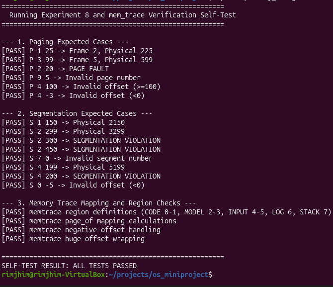

# Section 5: Experiment 8 - Paging and Segmentation

## Aim
To implement address translation using paging and segmentation and verify valid addresses, page faults, invalid page numbers, and segmentation violations.

## Use-case Connection
OrbitQueue simulates memory management for the onboard computer of the SomaiyaSat and SomaiyaPod PocketQube missions. Paging represents logical memory divided into fixed-size pages, while segmentation models regions such as code, model parameters, input buffers, output logs, and stack memory.

## Implementation
- Page size: 100 bytes.
- Logical pages: 8, with a predefined page table.
- Segments: CODE, MODEL_PARAMS, INPUT_BUFFER, OUTPUT_LOG, and STACK.
- Paging translates a logical page and offset using the page table.
- Segmentation checks the requested offset against the segment's base and limit.
- Invalid page numbers, unmapped pages, invalid offsets, and out-of-range segment accesses are rejected.

## Commands
```bash
./build/memory_management
./build/memory_management --test data/addr_tests.txt
./build/memory_management --selftest
```

## Screenshots

### Verification Self-Test Output
Terminal output from running `./build/memory_management --selftest` verifying paging address translation, page faults, and segmentation limits:



### Valid Address Translations
Terminal output showing address translation across valid logical pages and segment regions:

.png)

.png)

.png)

### Fault and Boundary Violation Handling
Terminal output demonstrating error handling for unmapped pages (page faults), invalid page numbers, out-of-bounds offsets, and segmentation limit violations:

.png)

.png)

.png)

## Testing and Observed Results
The Linux self-test passed. The address test suite also passed during the pipeline run.

| Test case | Expected behavior | Observed result |
|---|---|---|
| Valid mapped page and offset | Physical address returned | Passed |
| Unmapped page | Page fault reported | Passed |
| Invalid page number | Input rejected | Passed |
| Offset outside page bounds | Input rejected | Passed |
| Valid segment and offset | Address translated | Passed |
| Offset at or beyond segment limit | Segmentation violation | Passed |
| Invalid segment number | Input rejected | Passed |

## Post-lab Answers

### 1. Compare Paging and Segmentation
- **Paging:** Memory is partitioned into fixed-sized blocks (pages in logical memory, frames in physical memory). Address translation is performed using a page number and offset via a page table. Paging is invisible to the programmer and completely eliminates external fragmentation, though it can suffer from internal fragmentation in the final page.
  - *Satellite Example:* Fixed 100-byte page frames accommodate fixed-size network telemetry packet chunks or AX.25 frame buffers in OrbitQueue without causing external memory fragmentation across continuous orbital passes.
- **Segmentation:** Memory is divided into variable-sized logical segments reflecting program structure (e.g., CODE, DATA, STACK). Translation uses a segment table containing base address and limit registers. It provides logical protection and sharing based on module boundaries but can lead to external fragmentation.
  - *Satellite Example:* Isolating the critical routing engine (`CODE` segment) from the dynamic packet queue (`INPUT_BUFFER` segment) and flight telemetry (`OUTPUT_LOG` segment) ensures that a buffer overflow in packet processing cannot overwrite flight-control instructions.

### 2. Internal and External Fragmentation
- **Internal Fragmentation:** Occurs when allocated fixed-size memory blocks exceed the memory requested by a process. The unused space inside the allocated block is wasted.
  - *Satellite Example:* If an OrbitQueue telemetry record requires 65 bytes and the system allocates a standard 100-byte page frame, 35 bytes within that frame remain unused as internal fragmentation.
- **External Fragmentation:** Occurs when variable-sized partitions leave total free memory fragmented into small non-contiguous blocks across physical RAM. A new allocation request may fail even if the sum of all free blocks is sufficient.
  - *Satellite Example:* Dynamically allocating and deallocating variable-sized image chunks for Slow Scan Television (SSTV) payloads can leave scattered holes across satellite RAM, preventing the allocation of a contiguous 300-byte input buffer.

### 3. Translation Lookaside Buffer (TLB)
- **Concept:** The TLB is an associative, high-speed hardware cache that stores recent virtual-to-physical address mappings. When the processor requests a virtual address, the MMU checks the TLB first. On a TLB hit, the physical address is obtained immediately without referencing main memory page tables. On a TLB miss, the MMU accesses the page table in memory and updates the TLB.
  - *Satellite Example:* During repetitive routing lookups, memory references to the routing decision table hit the TLB, reducing memory access latency and minimizing power consumption on an energy-constrained satellite microcontroller.

### 4. Demand Paging
- **Concept:** In demand paging, pages are brought into physical memory only when accessed during program execution rather than loading the complete binary at initialization. When a referenced page is not resident in RAM, the MMU triggers a page fault exception, causing the operating system to fetch the required page from secondary storage.
  - *Satellite Example:* Non-critical diagnostic routines or contingency recovery algorithms for SomaiyaSat are kept in flash memory and loaded into scarce radiation-tolerant SRAM only when an anomalous hardware event triggers a demand page fault.

## Outcomes
- Demonstrated practical calculation of physical addresses from logical page and segment representations.
- Verified distinction between missing memory entries (page fault) and unauthorized boundary overruns (segmentation violation).
- Implemented boundary validation by rejecting invalid page indices, illegal offsets, and non-existent segment identifiers.
- Understood trade-offs between fixed-partition paging and variable-partition segmentation in embedded flight computers.

## Limitations
The page table and segment table are predefined for simulation. This experiment models address translation and boundary checking; it does not implement actual hardware MMU behavior or allocate physical memory for a satellite.

## Conclusion
The simulation demonstrates how paging and segmentation manage memory mapping and enforce spatial isolation between functional subsystems. Paging provides uniform allocation free of external fragmentation, while segmentation protects subsystem boundaries. While effective for validating address translation logic, the simulation operates on static tables rather than dynamic hardware MMU registers.
