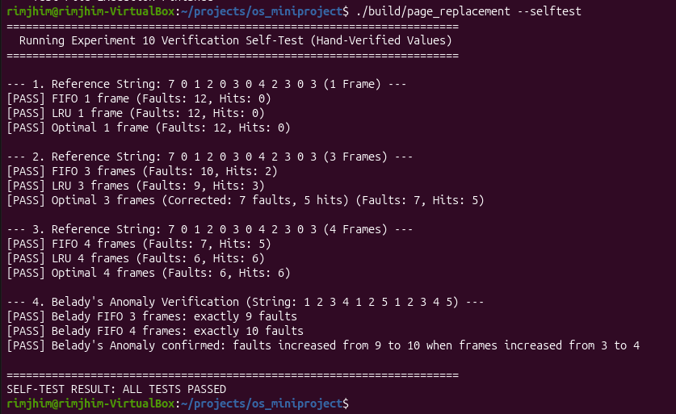
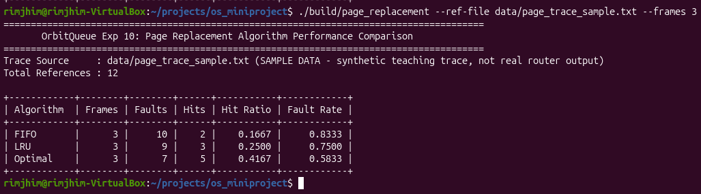

# Section 7: Experiment 10 - Page Replacement Algorithms

## Aim
To implement and compare FIFO, LRU, and Optimal page replacement algorithms by measuring page faults, hits, and hit and fault ratios for a given page-reference string.

## Use-case Connection
OrbitQueue models memory accesses generated by a simulated satellite routing workload. Page replacement algorithms are evaluated using logical page-reference traces to understand how different replacement strategies affect memory performance.

## Program and Steps
1. **Trace Parsing:** Read and validate a sequence of page references from an input file, ignoring comment lines starting with `#` and verifying that page numbers fall within the supported range (0 to 7).
2. **Frame Allocation:** Configure the number of physical page frames allocated for simulation (e.g., 1, 3, 4, or 5 frames).
3. **Algorithm Simulation:**
   - Maintain the resident frame set for each reference in the trace.
   - On a page hit, update algorithm-specific metadata (such as access timestamp in LRU).
   - On a page fault, select and evict a victim page according to the replacement policy (oldest arrival for FIFO, least recently used for LRU, and farthest future reference for Optimal with FIFO tie-breaking).
4. **Metrics Calculation:** Record total references, page hits, page faults, hit ratio ($\text{hits} / \text{total}$), and fault rate ($\text{faults} / \text{total}$).

## Algorithms
- **FIFO (First-In, First-Out):** Replaces the page that entered memory earliest.
- **LRU (Least Recently Used):** Replaces the page that has not been accessed for the longest time.
- **Optimal:** Replaces the page whose next use is farthest in the future. This serves as a theoretical lower bound for page faults.

## Commands
```bash
./build/page_replacement --ref-file data/page_trace_sample.txt
./build/page_replacement --ref-file data/page_trace_sample.txt --frames 1,3,4,5
./build/page_replacement --ref-file data/page_trace_sample.txt --frames 3 --verbose
./build/page_replacement --selftest
```

## Screenshots

### Verification Self-Test Output
Terminal output from `./build/page_replacement --selftest` confirming hand-verified test vectors and Belady's anomaly checks:



### Algorithm Performance Comparison Table
Comparison table across FIFO, LRU, and Optimal on the reference trace across allocated frame counts:



### Verbose Step-by-Step Frame Trace
Detailed step-by-step frame state and replacement tracking during simulation:

.png)

.png)

## Test Input
The sample reference string is:

`7 0 1 2 0 3 0 4 2 3 0 3`

The comparison below evaluates this 12-reference sequence using three page frames for all algorithms.

## Results

| Algorithm | Page faults | Hits | Hit ratio | Fault ratio |
|---|---:|---:|---:|---:|
| FIFO | 10 | 2 | 0.1667 | 0.8333 |
| LRU | 9 | 3 | 0.2500 | 0.7500 |
| Optimal | 7 | 5 | 0.4167 | 0.5833 |

## Manual Derivation

The manual trace derivations below verify the simulated results for the reference string `7 0 1 2 0 3 0 4 2 3 0 3` with three frames.

### 1. FIFO Derivation (3 Frames)
- Total References: 12 | Faults: 10 | Hits: 2

| Step | Page | Frame 1 | Frame 2 | Frame 3 | Status | Victim Page |
|:---:|:---:|:---:|:---:|:---:|:---:|:---:|
| 1 | 7 | 7 | - | - | Fault | - |
| 2 | 0 | 7 | 0 | - | Fault | - |
| 3 | 1 | 7 | 0 | 1 | Fault | - |
| 4 | 2 | 2 | 0 | 1 | Fault | 7 |
| 5 | 0 | 2 | 0 | 1 | Hit | - |
| 6 | 3 | 2 | 3 | 1 | Fault | 0 |
| 7 | 0 | 2 | 3 | 0 | Fault | 1 |
| 8 | 4 | 4 | 3 | 0 | Fault | 2 |
| 9 | 2 | 4 | 2 | 0 | Fault | 3 |
| 10 | 3 | 4 | 2 | 3 | Fault | 0 |
| 11 | 0 | 0 | 2 | 3 | Fault | 4 |
| 12 | 3 | 0 | 2 | 3 | Hit | - |

### 2. LRU Derivation (3 Frames)
- Total References: 12 | Faults: 9 | Hits: 3

| Step | Page | Frame 1 | Frame 2 | Frame 3 | Status | Victim Page |
|:---:|:---:|:---:|:---:|:---:|:---:|:---:|
| 1 | 7 | 7 | - | - | Fault | - |
| 2 | 0 | 7 | 0 | - | Fault | - |
| 3 | 1 | 7 | 0 | 1 | Fault | - |
| 4 | 2 | 2 | 0 | 1 | Fault | 7 |
| 5 | 0 | 2 | 0 | 1 | Hit | - |
| 6 | 3 | 2 | 0 | 3 | Fault | 1 |
| 7 | 0 | 2 | 0 | 3 | Hit | - |
| 8 | 4 | 4 | 0 | 3 | Fault | 2 |
| 9 | 2 | 4 | 0 | 2 | Fault | 3 |
| 10 | 3 | 4 | 3 | 2 | Fault | 0 |
| 11 | 0 | 0 | 3 | 2 | Fault | 4 |
| 12 | 3 | 0 | 3 | 2 | Hit | - |

### 3. Optimal Derivation (3 Frames)
- Total References: 12 | Faults: 7 | Hits: 5
- Note on Step 8: Frames hold `[2, 0, 3]`. The subsequent references are `2` (step 9), `3` (step 10), and `0` (step 11). Since page `0` has the farthest next use, it is replaced by page `4`, yielding 7 total faults.

| Step | Page | Frame 1 | Frame 2 | Frame 3 | Status | Victim Page | Notes on Next Use |
|:---:|:---:|:---:|:---:|:---:|:---:|:---:|:---|
| 1 | 7 | 7 | - | - | Fault | - | Initial load |
| 2 | 0 | 7 | 0 | - | Fault | - | Initial load |
| 3 | 1 | 7 | 0 | 1 | Fault | - | Initial load |
| 4 | 2 | 2 | 0 | 1 | Fault | 7 | 7 and 1 never reused; 7 arrived earlier |
| 5 | 0 | 2 | 0 | 1 | Hit | - | Page 0 in memory |
| 6 | 3 | 2 | 0 | 3 | Fault | 1 | Page 1 never reused |
| 7 | 0 | 2 | 0 | 3 | Hit | - | Page 0 in memory |
| 8 | 4 | 2 | 4 | 3 | Fault | 0 | Next uses: 2@9, 3@10, 0@11 (0 is farthest) |
| 9 | 2 | 2 | 4 | 3 | Hit | - | Page 2 in memory |
| 10 | 3 | 2 | 4 | 3 | Hit | - | Page 3 in memory |
| 11 | 0 | 0 | 4 | 3 | Fault | 2 | 2 and 4 never reused; 2 arrived earlier |
| 12 | 3 | 0 | 4 | 3 | Hit | - | Page 3 in memory |

## Analysis
For the standard 12-reference test sequence, Optimal produced the fewest page faults (7), followed by LRU (9) and FIFO (10). Optimal represents the minimum possible faults for any fixed-frame offline replacement strategy.

The implementation was also evaluated for Belady's anomaly using the reference string `1 2 3 4 1 2 5 1 2 3 4 5`:
- With 3 frames, FIFO produced 9 faults.
- With 4 frames, FIFO produced 10 faults.

This confirms the presence of Belady's anomaly in FIFO, where increasing allocated frames unexpectedly increases the number of page faults.

## Post-lab Answers

### 1. Comparison of FIFO, LRU, and Optimal
- **FIFO:** Replaces the page that has been in memory longest. Simple to implement using a queue or arrival timestamp, but ignores page access frequency and recency.
- **LRU:** Replaces the page that has not been accessed for the longest interval. Exploits temporal locality effectively, making it well-suited for general-purpose caching.
- **Optimal:** Replaces the page whose next reference occurs farthest in the future. Requires complete future knowledge of the reference trace.

### 2. Belady's Anomaly
Belady's anomaly describes the phenomenon where increasing the number of physical frames allocated to a process results in an increased number of page faults for certain reference sequences. It occurs in FIFO because FIFO is not a *stack algorithm*; the set of pages resident in $N$ frames is not necessarily a subset of the pages resident in $N+1$ frames. In contrast, stack algorithms like LRU and Optimal are immune to Belady's anomaly.

### 3. Why Optimal is a Theoretical Benchmark
The Optimal replacement algorithm requires perfect *a priori* knowledge of the future execution path and memory reference trace. In real-world operating systems, future memory references are non-deterministic and cannot be predicted in advance. Therefore, Optimal cannot be deployed online; it serves solely as an offline benchmark against which practical online algorithms like LRU are evaluated.

### 4. Trade-offs in Memory-Constrained Onboard Satellite Computers
In embedded satellite flight software:
- Full LRU tracking introduces processing and hardware overhead (e.g., maintaining linked lists, priority queues, or hardware timestamps on every memory cycle).
- FIFO involves negligible CPU overhead (simple circular pointer) but risks higher fault rates and Belady's anomaly under dynamic workloads.
- Practical satellite operating systems commonly implement approximations of LRU (such as the Clock / Second-Chance algorithm) to capture temporal locality with minimal memory and compute overhead.

## Outcomes
<!-- Note: Course Outcome (CO) mapping placeholder to be aligned with syllabus wording. -->
- Understood and implemented the mechanics of FIFO, LRU, and Optimal page replacement policies.
- Measured and analyzed fault rates and hit ratios across varying physical frame allocations.
- Derived manual step-by-step frame state traces and verified them against algorithmic simulation results.
- Verified Belady's anomaly experimentally and understood the distinction between queue-based and stack-based replacement policies.

## Limitations
These results are based on a synthetic sample trace. They demonstrate algorithm behavior and do not establish the performance of a real satellite onboard computer. The sample trace must not be described as a trace generated by the integrated router.

## Conclusion
The experiment verified that Optimal establishes the theoretical minimum fault count (7 faults), while LRU closely approximates this benchmark (9 faults) by leveraging temporal locality, outperforming FIFO (10 faults). Furthermore, the simulation confirmed Belady's anomaly under FIFO. All quantitative results derived manually match the automated simulation output exactly.
